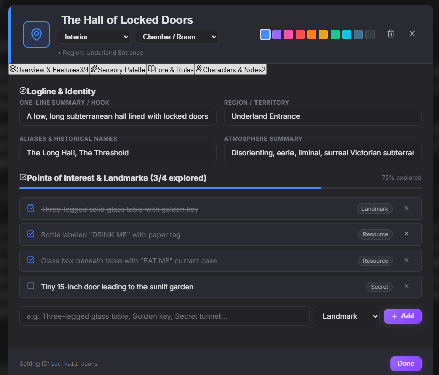

<div align="center">

  

  # ibuku

  **The Premier All-in-One Authoring & Publishing Studio for Novelists**

  *Distraction-free writing, dual-view author comments, visual narrative timelines, worldbuilding codex, offline neural audio proofreading, book cover designer, and print-ready PDF / EPUB 3 typesetter.*

  <br />

  <p>👇 Click below to download the latest desktop build directly from SourceForge:</p>

  <a href="https://sourceforge.net/projects/ibuku-authoring-suite/">
    
  </a>

</div>

<br />

*Note: This software was developed with the assistance of AI. Certain parts of the code have been generated using LLMs. However, the software does not collect any data from the user. The software is open source and free to use. The software is licensed under the AGPL v3 license.*

---

## 🌟 Why ibuku?

Writing a novel shouldn't require juggling four separate paid subscriptions. **ibuku** unifies the entire creative pipeline into one cohesive, distraction-free powerhouse:

- Replaces **Scrivener** with a fast, modern WYSIWYG chapter binder and dual-view author annotations.
- Replaces **Vellum** with publication-ready PDF typesetting and standard EPUB 3 exports.
- Replaces **World Anvil** with an integrated, private Worldbuilding Codex for character psychology and sensory locations.
- Replaces **Plottr / Aeon Timeline** with visual, multi-strand narrative timelines that prevent plot-hole collisions.
- Replaces paid **TTS proofreaders** with private, on-device Kokoro Text-to-Speech voice audio.

### 🛡️ 100% Local-First & Private
- **Zero Telemetry**: ibuku collects no metrics, no trackers, and has no remote database.
- **100% GenAI-Free. No LLMs. No text generation. Built exclusively for human writers.**
- **No Cloud Lock-in**: Your work is saved in the open `.ibuku` format (a standard ZIP archive containing plain JSON and raw XHTML).
- **Optional Private Sync**: Sync directly to your own self-hosted WebDAV server (Nextcloud, ownCloud, Fastmail) with end-to-end credential storage.

---

## 🚀 Key Features

### 🖋️ Distraction-Free Chapter Authoring
- **Modern WYSIWYG Canvas**: Pure, zero-jitter writing experience with customizable typography, margins, and line spacing.
- **Chapter Binder & Splitter**: Reorder chapters with drag-and-drop or split large scenes at cursor position in one click.
- **Live Word Count & Goals**: Track chapter lengths, overall manuscript progress, and daily word targets.

### 💬 Dual-View Author Comments
- **Side-by-Side & Inline Highlighting**: Select any passage to attach notes, plot questions, or revision reminders using a 6-color palette.
- **Zero-Leakage Export Guarantee**: All comments and annotations are automatically stripped upon publishing, guaranteeing clean, professional files.

### 🕸️ Interactive Narrative Timeline Studio
- **Multi-Strand Plotting**: Track main plots, subplots, and character arcs simultaneously.
- **Flexible Timescales**: Zoom from granular hours and days to months and years.
- **Visual Collision Lanes**: Prevent continuity errors and impossible character overlaps before you finish your draft.

### 📖 Deep Worldbuilding Codex
- **Character Dossiers**: Document archetypes, character arcs, physical appearances, psychological traits, and backstory secrets.
- **Sensory Location Dossiers**: Capture sight, sound, smell, weather, history, hazards, and connected characters for every setting.

<div align="center">
  
</div>

### 🎨 Built-In Book Cover Designer
- Craft typography-rich, custom book covers without leaving the app.
- Configure titles, subtitles, author credits, backgrounds, gradients, borders, and decorative emblems with high-resolution export.

### 🔊 Offline Kokoro TTS Voices
- Listen to your chapters read aloud by state-of-the-art Kokoro TTS voice models running directly on your computer via WebGPU / WASM.
- Catch clunky phrasing, dialogue hitches, and typos without sending a single byte of your story to external servers.

### 📄 Publication-Grade Exporters
- **Print PDF**: Automated book formatting with mirror margins, running headers, drop caps, Roman numeral front matter, and proper chapter page breaks.
- **Standard EPUB 3**: Valid, reflowable EPUB files verified for Amazon Kobo, Kindle, and Apple Books.
- **Shunn Manuscript Format (DOCX)**: Formats your manuscript strictly according to the industry-standard William Shunn format for literary agent and editor submissions.
- **ibuku Project (`.ibuku`)**: Comprehensive project backup preserving all drafts, codex dossiers, timelines, covers, and author comments in an open ZIP package.

---

## 🖥️ Cross-Platform & Downloads

ibuku is available as both a native standalone desktop app (Windows & macOS) and an in-browser web app:

| Platform | Format | Description | Download / Launch |
| :--- | :--- | :--- | :--- |
| **In-Browser** | Web Studio | Runs client-side in Chrome, Edge, Safari, Firefox | [**Launch Online**](https://mwakidenis.github.io/ibuku/app/) |
| **Desktop App** | Windows (`.exe`) & macOS (`.dmg`) | Standalone desktop app — **Pay What You Want ($0+)** | [**Get on SourceForge**](https://sourceforge.net/projects/ibuku-authoring-suite/) |

> [!TIP]
> The desktop application does not need an installer or administrative rights. Get it on [SourceForge](https://sourceforge.net/projects/ibuku-authoring-suite/) for free or with an optional donation to support open-source software! Open it, and start writing immediately.

---

## 🛠️ Development & Building

### Prerequisites
- [Node.js](https://nodejs.org/) (v18.0.0 or later)
- [npm](https://www.npmjs.com/) (v9 or later)
- [Rust toolchain](https://rustup.rs/) (required only if building the native Tauri desktop app)

### 1. Clone & Install Dependencies
```bash
git clone [https://github.com/mwakidenis/ibuku.git](https://github.com/mwakidenis/ibuku.git)
cd ibuku
npm install
